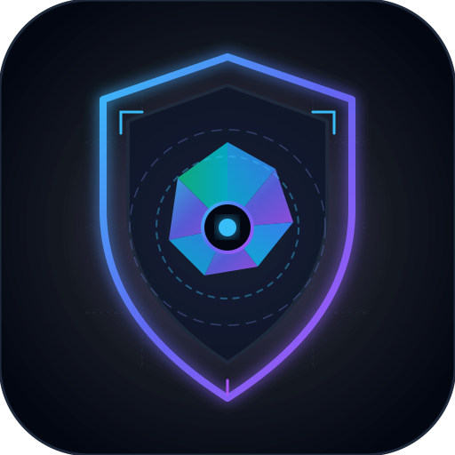
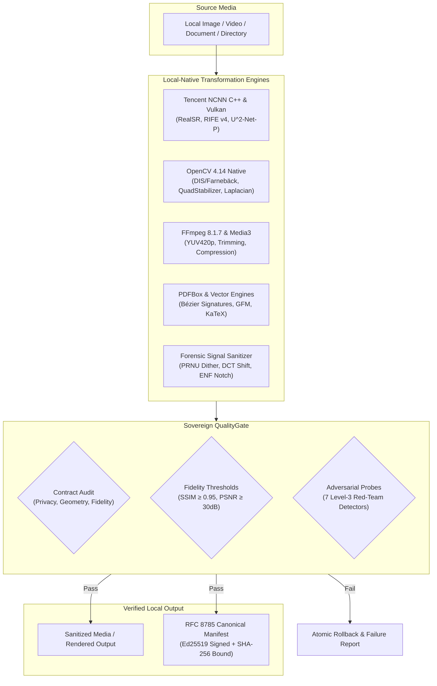
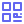
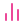
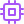
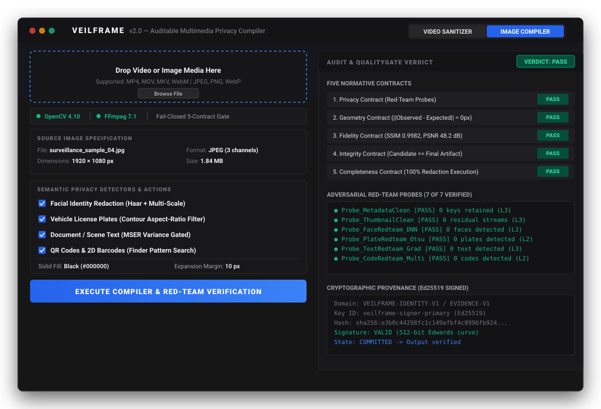
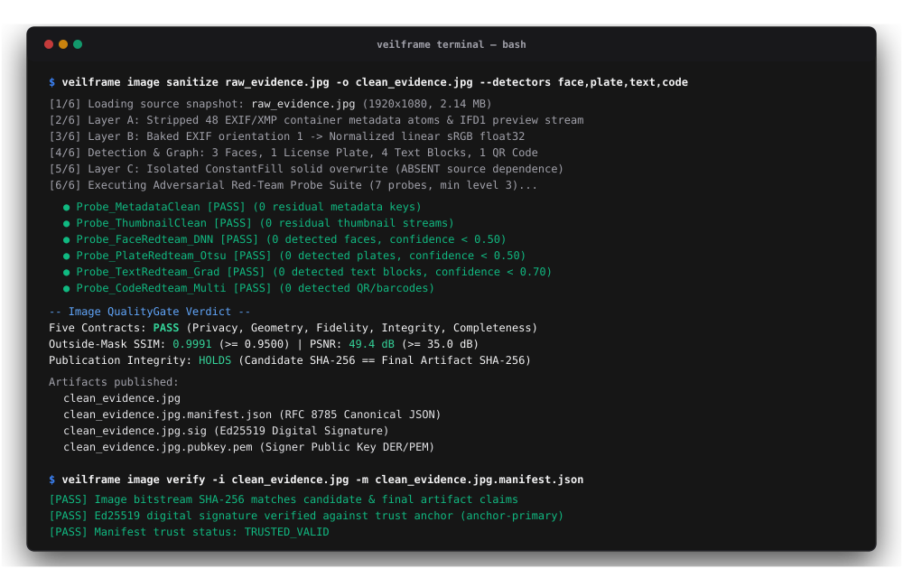

<p align="center">
  
  <br />
  <h1 align="center">VeilFrame</h1>
  <p align="center"><b>Offline-First Multimedia Engineering, Forensic Signal Transformation, AI Super-Resolution & Privacy Compilation Platform</b></p>
</p>

<p align="center">
  <a href="https://github.com/sahir247/VeilFrame/releases/tag/v2.3.0"></a>
  <a href="https://github.com/sahir247/VeilFrame"></a>
  <a href="https://kotlinlang.org/"></a>
  <a href="https://python.org/"></a>
  <a href="https://github.com/Tencent/ncnn"></a>
  <a href="https://www.vulkan.org/"></a>
  <a href="https://ed25519.cr.yp.to/"></a>
  <a href="https://datatracker.ietf.org/doc/html/rfc8785"></a>
  <a href="LICENSE"></a>
</p>

---

##  Executive Overview

**VeilFrame** is an offline-native multimedia engineering, signal transformation, and privacy compilation workstation. Built from the ground up for zero-trust environments, VeilFrame eliminates cloud dependencies and guarantees **100% on-device data sovereignty** across Mobile (Android) and Desktop (Windows, Linux, macOS).

Originally architected as a specialized bitstream privacy sanitizer, VeilFrame has grown into a comprehensive workstation organizing **14 dedicated creative, computer vision, document, and forensic studios** into 5 cohesive operational domains.

>  **Zero Cloud Guarantee**<br>
> VeilFrame operates entirely offline. It does not transmit telemetry, analytics, user media, or diagnostic crash reports to any external server. Every neural model, optical flow pass, document transformation, and cryptographic signature runs strictly on local silicon.

---

##  The Five Core Domains

To make VeilFrame's extensive toolset easy to navigate, its 14 workspaces are organized into **5 core operational domains**:

```
                                  [ VeilFrame Core Engine ]
                                             │
      ┌──────────────────┬───────────────────┼───────────────────┬──────────────────┐
      ▼                  ▼                   ▼                   ▼                  ▼
[ AI & Vision ]    [ Media ]           [ Documents ]       [ Privacy ]        [ Dev & Provenance ]
• AI Upscaler      • Video Studio      • PDF Studio Hub    • Video Sanitizer  • AI Context Bundler
• Motion Lab       • Image Studio      • Vector Signature  • Image Compiler   • Folder Forensics
• Background Mat   • Visual Compress   • Document Scanner  • Quality Forensics• Ed25519 Provenance
• QR Code Studio                       • Markdown Studio
```

### 1.  AI & Neural Computer Vision
High-throughput on-device neural processing powered exclusively by **native Tencent NCNN C++** and **Vulkan GPU compute**, completely free of ONNX dependencies:
* **AI Image Upscaler:** Native RealSR and Real-ESRGAN super-resolution (2×, 3×, 4×) with dual Vulkan compute queues, smoothstep Hermite tiled streaming, and dynamic memory governance.
* **Motion Lab:** AI neural frame synthesis powered by **RIFE v4** with a dedicated default **60 FPS target mode**, dynamic timestep scheduling, and OpenCV DIS/Farnebäck optical flow fallbacks.
* **Background Remover & Adaptive Detail Enhancer:** High-speed U^2-Net-P segmentation with morphological trimap generation, guided alpha filtering, and an interactive on-screen touch brush/eraser canvas (`RefineBrushCanvasView`).
* **QR Code Studio:** Cleanroom EFQRCode 7.0.3 parity with 11 artistic visual rendering modes, pure vector SVG export, and real-time CameraX WeChatQRCode scanning.

### 2.  Creative Media Processing
Local-first video and image post-processing with zero loss of control:
* **Video Studio & Visual Compressor:** Powered by FFmpeg 8.1.7 and Media3 ExoPlayer. Features sub-100ms instant preview via direct URIs, guaranteed universal YUV420p output encoding, timeline range trimming, and platform delivery presets (WhatsApp 16 MB, Discord, Web Faststart).
* **Image Studio & Creative Compressor:** Continuous quality scaling (1–100%), multi-lobe Lanczos-3 resampling, aspect-ratio cropping, official Passport 600×600 preset, color grading filters, and zero-leakage EXIF metadata scrubbing.

### 3.  Document & Vector Studios
Precision document manipulation and cryptographic signing:
* **PDF Studio Hub:** Symmetrical 10-tool grid providing Merge, Split, Reorder, Rotate, Delete, Extract, Compress, Lock/Unlock, Watermark, and AcroForm processing.
* **Smooth Bézier Signature Pad:** Interactive on-screen signature pad with Catmull-Rom cubic Bézier curve smoothing, velocity-sensitive stroke width tapering, and 3.5× supersampled PDFBox vector export.
* **Document Scanner:** Real-time EMA corner stabilization ($\alpha=0.4$, 4-hit hysteresis) eliminating quad jitter, interactive per-page exposure/contrast/saturation adjustment, and progressive multi-page PDF generation.
* **Offline Markdown Studio:** Offline GitHub Flavored Markdown (GFM) editor with live split-view preview, embedded KaTeX formulas, Mermaid diagrams, and one-click export to Markdown, PDF (with Light/Dark print styles), and DOCX.

### 4.  Forensic Privacy & Sanitization
Mathematical privacy compilation and bounded signal disruption:
* **Video Privacy Sanitizer:** Bitstream SEI NAL scrubbing, physical Bayer CFA PRNU sensor dither, 2D DCT perceptual hash perturbation, and acoustic electrical network frequency (ENF) mains notch filtering.
* **Image Privacy Compiler:** Deterministic 3-layer compilation with ConstantFill solid redaction, 8-bit sRGB quantization normalization, 7 Level-3 adversarial red-team probes, and a 5-contract QualityGate.
* **Image Quality Forensics:** Independent computer vision evaluation analyzing Laplacian sharpness, Gaussian noise variance, dynamic range entropy, and exposure clipping without fabricated score fallbacks.

### 5.  Developer Intelligence & Cryptographic Provenance
Structured codebase compilation and zero-trust evidence validation:
* **AI Context Bundler (`.aibundle` v1):** Zero-truncation codebase packaging compiler for LLMs and autonomous agents with priority knapsack token budgeting (32k–1M), explicit depth bounding, and syntax-preserving credential masking.
* **Folder Forensics & Staged Duplicate Finder:** Selective `os.scandir()` traversal, SQLite3 indexing, and staged 3-tier duplicate detection (size $\to$ 16 KiB head/tail $\to$ full streaming SHA-256).
* **Cryptographic Provenance:** RFC 8785 Canonical JSON evidence manifests bound with Ed25519-SHA512 digital signatures and neutral initial verification dashboards.

---

##  System Architecture

VeilFrame enforces a strict architectural invariant across all platforms:

> **"Providers measure. VeilFrame decides."**<br>
> Transformation engines, neural models, and red-team detectors never decide whether media passes. All pass/fail verdicts are owned exclusively by the independent, read-only **QualityGate**.



---

##  Detailed Workspace Capabilities

### 1.  AI Image Super-Resolution (Native NCNN / RealSR)
VeilFrame delivers 100% offline neural super-resolution executing exclusively on **native Tencent NCNN C++ binaries (`realsr_jni.cpp`)** accelerated via Vulkan GPU compute:
* **Models Available:** Real-ESRGAN x4plus (universal photo), Real-ESRGAN AnimeVideoV3 (2×, 3×, 4× compact anime), RealSR DF2K (high-fidelity photo), RealSR DF2K JPEG (artifact suppression), and Real-ESRGAN HFA2k (facial textures).
* **Model-Aware Honest Scales:** Dynamic scale selector (`2×`, `3×`, `4×`) that enables only the native scales supported by the active model without artificial multi-pass interpolation.
* **Tiled Streaming & Memory Governor:** Configurable tile dimensions with smoothstep Hermite blending to eliminate seams, backed by disk streaming sinks for ultra-high-resolution images exceeding physical RAM.
* **Broad Fleet Hardware Certification:** Fully validated on Qualcomm Snapdragon (Adreno 730/740) and MediaTek Dimensity (Dimensity 7300 Mali-G615 MC2) with dual Vulkan compute queues (`queueC=0[2]`, `queueT=0[2]`).

### 2.  Motion Lab: RIFE v4 AI Neural Frame Synthesis & 60 FPS Mode
Motion Lab provides zero-trust, on-device video frame interpolation targeting high frame rates:
* **RIFE v4 AI Neural Synthesis:** State-of-the-art Real-time Intermediate Flow Estimation running on hardware Vulkan compute alongside CPU OpenMP multi-threading.
* **Dedicated 60 FPS Target (Default):** Automatically calculates intermediate temporal timesteps ($t=0.5$ for 24–30 FPS sources; $t=0.25, 0.50, 0.75$ for $\le 20$ FPS sources) to produce smooth 60.000 FPS video.
* **Optical Flow Fallbacks:** High-speed DIS Optical Flow and dense Farnebäck Optical Flow algorithms.
* **Clean Gallery Export:** Encodes to universal YUV420p MP4 committed directly to `Movies/VeilFrame` in the device gallery.

### 3.  Background Remover & Adaptive Detail Enhancer
Portrait and object matting with transparent alpha output:
* **Native U^2-Net-P Segmentation:** Quantized U^2-Net-P running in native C++ memory (`matting_jni.cpp`) for instant salient object isolation.
* **Adaptive Detail Enhancer:** Hybrid dual-model segmentation combining coarse masks with morphological trimap generation and a guided alpha filter to retain fine strands of hair and subtle edges.
* **Interactive Touch Refine Canvas (`RefineBrushCanvasView`):** On-screen touch brush and eraser tools with live concentric circle stroke preview, gesture isolation (smooth two-finger panning/zooming without UI conflicts), and complete undo/redo history.
* **Direct Gallery Export:** Transparent PNGs saved to `Pictures/VeilFrame` with Android 10+ MediaStore compliance.

### 4.  QR Code Studio (EFQRCode Parity, 11 Modes & Live Scanner)
Artistic QR code generation and decoding:
* **11 Visual Styles:** Basic, Bubble, 2.5D Isometric, DSJ Turntable, Image Fill, Image Overlay, Image Resample, Line, Random Rectangle, Function, and Style Function.
* **Cleanroom EFQRCode 7.0.3 Parity:** Authoritative Canonical Geometry IR (`effectiveDesignForMode()`) guaranteeing deterministic shape, quiet zone, and node order parity.
* **Vector & Animated SVG:** Full XML `<path>` and `<rect>` SVG output without raster blurring, plus animated GIF/SVG generation.
* **Live CameraX Scanner:** Real-time WeChatQRCode CNN detector with animated corner-bracket reticle (`QrScanOverlayView`) and safe payload parsing across 11 formats (Wi-Fi, UPI payments, URLs with anti-phishing defense, vCards, etc.).

### 5.  PDF Studio Hub & Smooth Vector Signature Pad
All-in-one document suite with clean symmetry:
* **Symmetrical 10-Card Hub:** Standardized `112dp` uniform cards covering Merge, Split, Reorder, Rotate, Delete, Extract Pages, Compress, Lock/Unlock, Watermark, and Form Filling.
* **Smooth Bézier Signature Pad (`SignaturePadView`):** Replaces jagged touch lines with Catmull-Rom cubic Bézier curve smoothing, velocity-sensitive stroke width tapering, and single-tap dot generation.
* **3.5× Supersampled Vector Export:** Crisp anti-aliased PDFBox vector signature embedding, eliminating pixelation upon PDF placement.

### 6.  Document Scanner & Progressive PDF Exporter
Offline camera document capture powered by OpenCV 4.14.0:
* **Real-Time QuadStabilizer:** Exponential Moving Average (EMA, $\alpha=0.4$) corner filtering with 48px tolerance and 4-hit hysteresis, eliminating viewfinder quad jitter and strobing.
* **Per-Page Image Adjust Dialog:** Interactive adjustment for Exposure (−2..+2 stops), Contrast (0.5..2×), and Saturation (0..2×) backed by `cv/color/ColorEngine`.
* **Progressive Multi-Page PDF:** Configurable page dimensions (A4, Letter, Legal), margins, and orientation.

### 7.  Video Studio & Visual Compressor
Dedicated video compression and editing powered by FFmpeg 8.1.7 and Media3 ExoPlayer:
* **Sub-100ms Instant Preview:** Direct URI handoff to Media3 ExoPlayer eliminating intermediate disk copies and cache stalls.
* **Universal YUV420p Compatibility:** Guaranteed `-pix_fmt yuv420p` encoding across all export paths for seamless playback on legacy hardware decoders and messaging apps.
* **Visual Scrubber & Presets:** Dual-thumb timeline trimmer and target size budget presets (WhatsApp 16 MB, Discord 25/50 MB, Email 8/25 MB, Web faststart).
* **Multi-Codec Support:** H.264, H.265, VP9, and AV1 in MP4, MKV, WebM, MOV, and AVI containers.

### 8.  Image Studio & Creative Compressor
Deep image transformation and compression studio:
* **Continuous Quality Compression:** Precision quality scaling (1% to 100%) with empirical output size estimation.
* **Dimension Scaling & Cropping:** Multi-lobe Lanczos-3 resampling, arbitrary scaling, and aspect-ratio cropping (Free, 1:1, 4:3, 16:9, 9:16).
* **Official Passport Preset:** Dedicated 600×600 px document export preset with strict 1:1 aspect constraint.
* **Color Grading & EXIF Scrubbing:** Grayscale, Sepia, Vintage, Cool, and Warm tone grading with zero-leakage metadata scrubbing.

### 9.  Video Privacy & Bounded Forensic Disruption
Bounded orthogonal signal perturbations disrupting machine re-identification while preserving perceptual quality:
* **Physical Bayer CFA PRNU Sensor Dither:** Neutralizes sensor-level silicon fingerprinting.
* **2D DCT Transform Perturbation:** Modifies frequency-domain perceptual hashes.
* **Acoustic ENF Mains Filter:** High-Q multi-order IIR notch filters targeting 50 Hz, 60 Hz, 100 Hz, and 120 Hz power-grid hums.
* **Three-Tier QualityGate:** Enforces Mean SSIM $\ge 0.95$, Tail P5 SSIM $\ge 0.90$, Worst-Case SSIM $\ge 0.85$, Mean PSNR $\ge 30.0\text{ dB}$, and strictly monotonic presentation timestamps.

### 10.  Image Privacy Compiler
Deterministic privacy compiler audited against independent adversarial red-team probes:
* **Multi-Layer Pipeline:** Container metadata stripping $\to$ Quantization normalization (8-bit sRGB) $\to$ ConstantFill solid redaction.
* **Adversarial Red-Team Probes:** 7 independent Level-3 detectors (Face, License Plate, Text OCR, QR/Barcode, Boundary Fringe).
* **Five Normative Contracts:** Privacy (0 residual detections), Geometry ($\|Obs - Exp\|_\infty = 0$), Fidelity ($D_{TV} \le \text{budget}$), Integrity ($\alpha \in \{0, 1\}$), and Completeness.

### 11.  Image Quality Forensics & Visual Audit
Objective computer vision analysis evaluating image integrity and defects:
* **Metric Scoring:** Laplacian variance sharpness, Gaussian noise variance, dynamic range entropy, and exposure clipping.
* **Honest Diagnostics:** Structured scoring cards with categorized verdicts (Excellent, Good, Fair, Poor) without fabricated score fallbacks.

### 12.  Folder Forensics & Staged Duplicate Finder
High-performance selective directory analyzer:
* **Fast Scanning:** Traversal via `os.scandir()` with SQLite3 persistent indexing.
* **Staged 3-Tier Duplicate Engine:** Exact byte-size partitioning $\to$ 16 KiB head/tail staged fingerprinting $\to$ Streaming full SHA-256 verification.
* **Comprehensive Reporting:** Full uncut 64-character SHA-256 reports exported to interactive HTML, Markdown, CSV, and JSON.

### 13.  AI Project Intelligence & Context Bundler (`.aibundle`)
Deterministic codebase packaging compiler designed for Large Language Models and AI coding agents:
* **Zero-Truncation Guarantee:** Selected files are delivered in their entirety; no middle-slicing or truncated code fragments.
* **Priority Knapsack Budgeting:** Strict token ceilings (32k, 64k, 128k, 200k, 1M, or Unlimited).
* **Syntax-Preserving Secret Masking:** Shannon entropy scanners and regexes mask credentials (`[REDACTED]`) without breaking file syntax.
* **Structural Outlining:** AST signature extraction for Python, TypeScript, Go, Rust, Java, and C++.

### 14.  Offline Markdown Studio & Multi-Format Exporter
Integrated offline GitHub Flavored Markdown workspace:
* **Dual-Pane Live Preview:** Split-view or full-screen rendering of GFM documentation.
* **Offline Diagrams & Math:** Embedded Mermaid diagram synthesis and KaTeX mathematical typesetting without internet access.
* **Unified Export:** Single "Save As" menu for Markdown (`.md`), PDF (`.pdf`), and Word (`.docx`) with Light/Dark print styles.

---

##  Downloads & Installation

Pre-built release packages are available on the [GitHub Releases Page](https://github.com/sahir247/VeilFrame/releases/tag/v2.3.0):

| Platform | Package / Asset | Target Architecture | Notes |
|---|---|---|---|
| **Android** | `VeilFrame-android-arm64.apk` | ARM64-v8a (API 26+) | Full native NCNN C++, Vulkan compute, MediaStore sync |
| **Windows** | `VeilFrame-windows-x86_64.exe` | x86_64 (Windows 10/11) | Standalone desktop GUI & CLI executable |
| **Linux (Debian/Ubuntu)** | `VeilFrame-linux-x86_64.deb` | x86_64 (glibc 2.31+) | System desktop package with launcher integration |
| **Linux (Portable)** | `VeilFrame-linux-x86_64.tar.gz` | x86_64 | Portable standalone binary bundle |
| **macOS (Installer)** | `VeilFrame-macos-arm64.dmg` | Apple Silicon (M1/M2/M3/M4) | Signed desktop application bundle |
| **macOS (Portable)** | `VeilFrame-macos-arm64.tar.gz` | Apple Silicon (M1/M2/M3/M4) | Portable standalone executable bundle |
| **Python Package** | `veilframe-2.3.0-py3-none-any.whl` | Universal (`pip install`) | CLI and headless transformation engine |

```bash
# Install Python package from wheel
pip install veilframe-2.3.0-py3-none-any.whl

# Or install from source
git clone https://github.com/sahir247/VeilFrame.git
cd VeilFrame
pip install -e .
```

---

##  Desktop Graphical Interface (GUI)

VeilFrame includes a modern, high-performance desktop GUI built with PySide6 / Qt:



```bash
# Launch the desktop GUI
veilframe gui
# or directly:
veilframe-gui
```

---

##  Terminal Command-Line Interface (CLI)



### CLI Command Reference

| Command | Action |
|---|---|
| `veilframe sanitize <video> -o <out>` | Multi-pass video privacy sanitization with 3-tier QualityGate audit |
| `veilframe video compress <video> [opts]` | Video compression, visual range trimming, scaling & platform presets |
| `veilframe image sanitize <image> -o <out>` | Deterministic image compilation with 5-Contract QualityGate |
| `veilframe image compress <image> [opts]` | Image compression, Lanczos-3 resize, EXIF scrub, rotation & grading |
| `veilframe image verify <image> <manifest>` | Cryptographic image provenance and bitstream verification |
| `veilframe image inspect <image>` | Deep inspection of image EXIF, XMP, IPTC, and embedded thumbnails |
| `veilframe folder scan <dir>` | High-performance selective directory analysis with configurable presets |
| `veilframe folder dupes <dir>` | 3-stage duplicate file detection with wasted space calculations |
| `veilframe folder stats <dir>` | Statistical size rollups, file type distributions, and directory depth |
| `veilframe folder export <dir> -o <out>` | Export comprehensive reports to interactive HTML, MD, JSON, CSV, TXT |
| `veilframe folder ai <dir> -o <out>` | Compile codebase into `.aibundle` v1, Markdown, HTML, JSON, or ZIP |
| `veilframe inspect <video>` | Deep inspection of container atoms, elementary streams, and GPS tags |
| `veilframe audit <ref> <trans>` | Independent visual-fidelity audit of reference vs transformed media |
| `veilframe verify <manifest>` | Standalone Ed25519 signature and SHA-256 bitstream verification |
| `veilframe doctor` | System diagnostic check for OS, Python, FFmpeg, and GPU encoders |

---

##  Forensic Disruption Policy Presets

VeilFrame provides three mathematically calibrated presets for forensic sanitization:

| Feature / Policy Dimension | 5% Forensic Disruption | 10% Forensic Disruption | Privacy Clean |
|---|:---:|:---:|:---:|
| **Aggregate Policy Ceiling ($S_{\text{policy}}$)** | $\le 5.0\%$ | $\le 10.0\%$ | $0.0\%$ |
| **Spatial Geometry Ceiling ($\Delta_{\text{spatial}}$)** | $\le 2.0\%$ (99.8% Lanczos) | $\le 4.0\%$ (99.5% Lanczos, 2-4px crop) | $0.0\%$ (No crop/scale) |
| **Temporal Dynamics Ceiling ($\Delta_{\text{temporal}}$)** | $\le 1.0\%$ ($\pm 0.2\%$ speed) | $\le 2.0\%$ ($\pm 0.5\%$ speed) | $0.0\%$ (Preserved) |
| **Luminance Drift Ceiling ($\Delta_{\text{luma}}$)** | $\le 1.0\%$ (0.5% luma, 1.5% gamma) | $\le 2.0\%$ (0.8% luma, 2.5% gamma) | $0.0\%$ (Original) |
| **Chrominance Drift Ceiling ($\Delta_{\text{chroma}}$)** | $\le 1.0\%$ (2.0% sat) | $\le 2.0\%$ (3.0% sat) | $0.0\%$ (Original) |
| **Frequency Noise Ceiling ($\Delta_{\text{freq}}$)** | $\le 1.0\%$ (Gaussian Noise) | $\le 2.0\%$ (Bayer CFA PRNU) | $0.0\%$ (Disabled) |
| **DCT Hash Perturbation** | Off | Enabled ($\text{SSIM} \ge 0.95$) | Off |
| **Audio ENF Notch Filtration** | 50/60/100/120 Hz | 50/60/100/120 Hz | Off |
| **QualityGate: Mean SSIM** | $\ge 0.9500$ | $\ge 0.9000$ | $\ge 0.9500$ |
| **QualityGate: Worst-Case SSIM** | $\ge 0.8500$ | $\ge 0.8000$ | $\ge 0.8500$ |
| **QualityGate: Mean PSNR** | $\ge 30.0\text{ dB}$ | $\ge 28.0\text{ dB}$ | $\ge 30.0\text{ dB}$ |
| **Metadata & SEI NAL Scrub** | Full scrub | Full scrub | Full scrub |

---

##  Cryptographic Evidence Manifest

Every sanitized output generates an RFC 8785 canonical JSON manifest cryptographically signed with Ed25519:

```json
{
  "schema_version": "2.0.0",
  "media_type": "image",
  "input_sha256": "e3b0c44298fc1c149afbf4c8996fb92427ae41e4649b934ca495991b7852b855",
  "output_sha256": "4a5e1e4baab89f3a32518a88c31bc87f618f76673e2cc77ab2127b7afdeda33b",
  "contracts": {
    "privacy": "PASS",
    "geometry": "PASS",
    "fidelity": "PASS",
    "integrity": "PASS",
    "completeness": "PASS"
  },
  "signature": {
    "algorithm": "Ed25519",
    "public_key_fingerprint": "SHA256:...",
    "signature_bytes_base64": "..."
  }
}
```

---

##  Building & Verification

### Android Mobile App
```powershell
# Build debug APK
.\gradlew.bat assembleDebug

# Run comprehensive unit test suite
.\gradlew.bat :app:testDebugUnitTest
```

### Python Desktop & CLI
```bash
# Run Python test suite
pytest

# Type checking and linting
ruff check .
mypy veilframe
```

---

##  Limitations & Non-Guarantees

1. **Semantic Content:** VeilFrame neutralizes physical sensor fingerprints, acoustic power-grid hums, container metadata, and identified regions of interest. It cannot redact spoken dialogue or textual information that the user does not select for redaction.
2. **Extreme Adversaries:** Against manual human analysts with out-of-band context, visual surroundings that are left unredacted may still provide contextual clues.
3. **Lossless Bit-for-Bit Identity:** Bounded forensic signal perturbation intentionally modifies pixel values within strict perceptual budgets; for 100% bitstream identity preservation, select the **Privacy Clean** preset.

---

##  License & Security

* **License:** [MIT License](LICENSE).
* **Security Policy:** See [SECURITY.md](SECURITY.md) for vulnerability disclosure procedures and threat model documentation.
